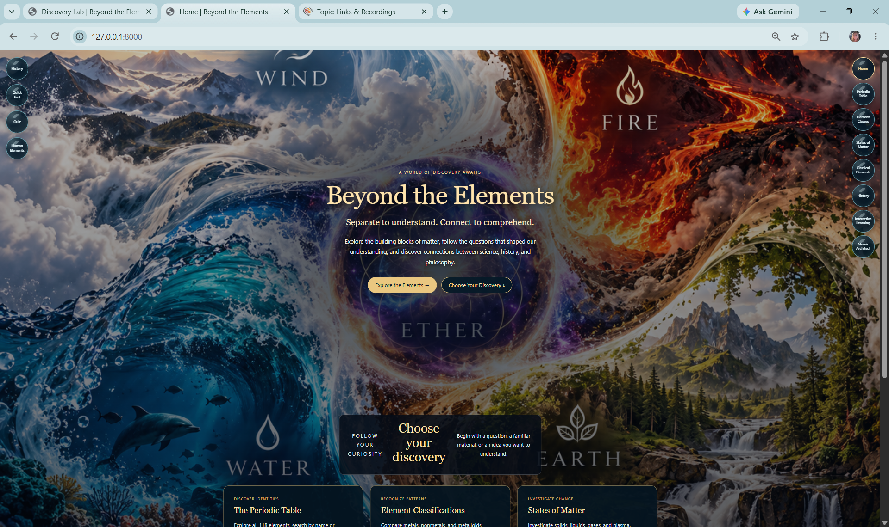
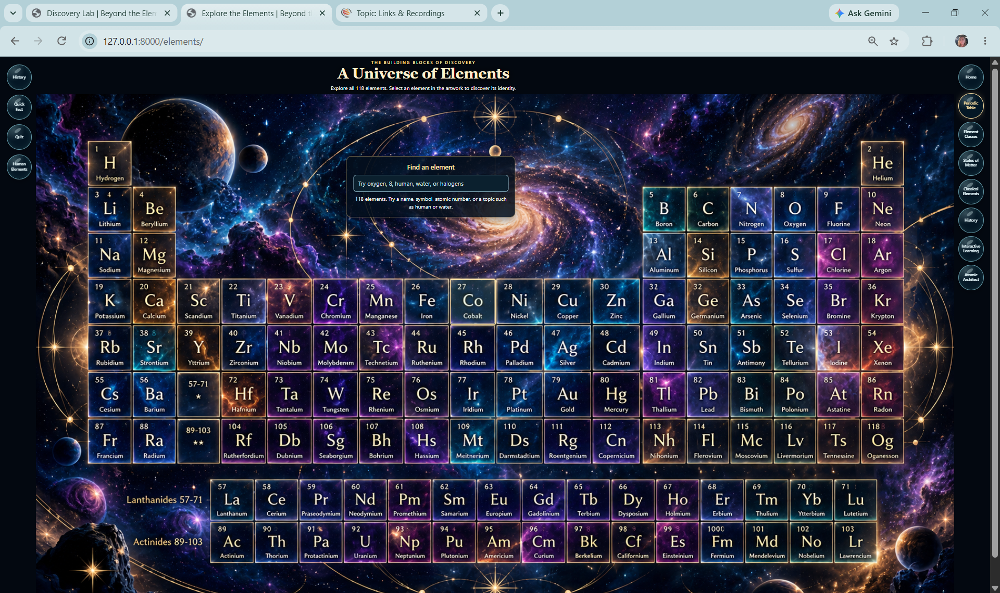
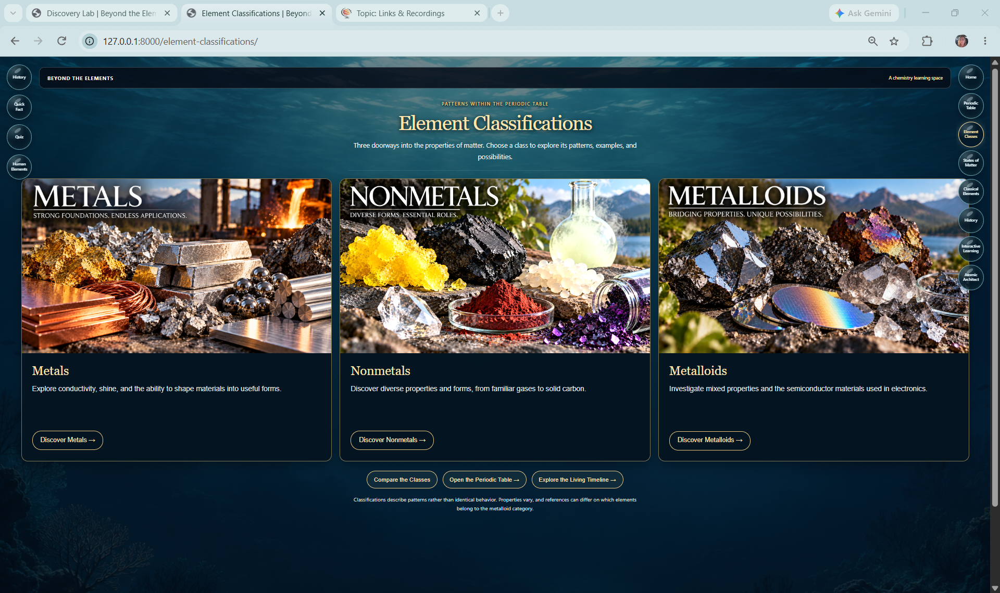
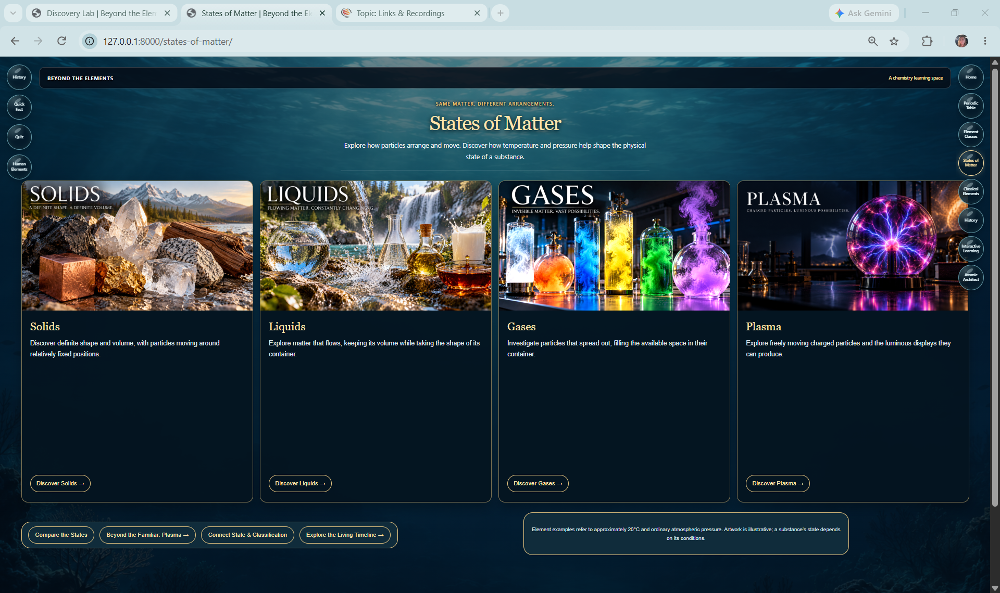
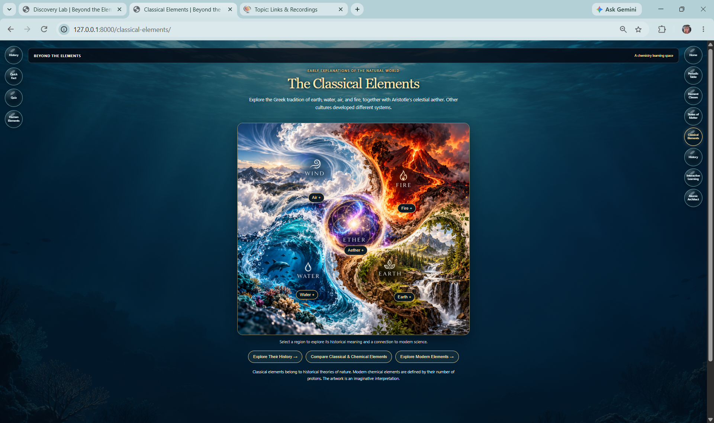
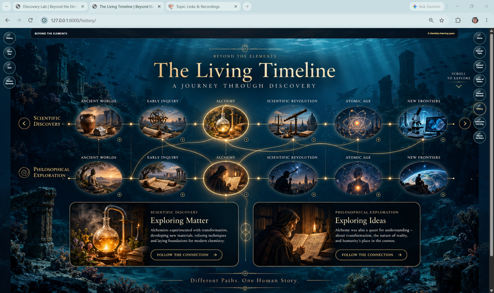
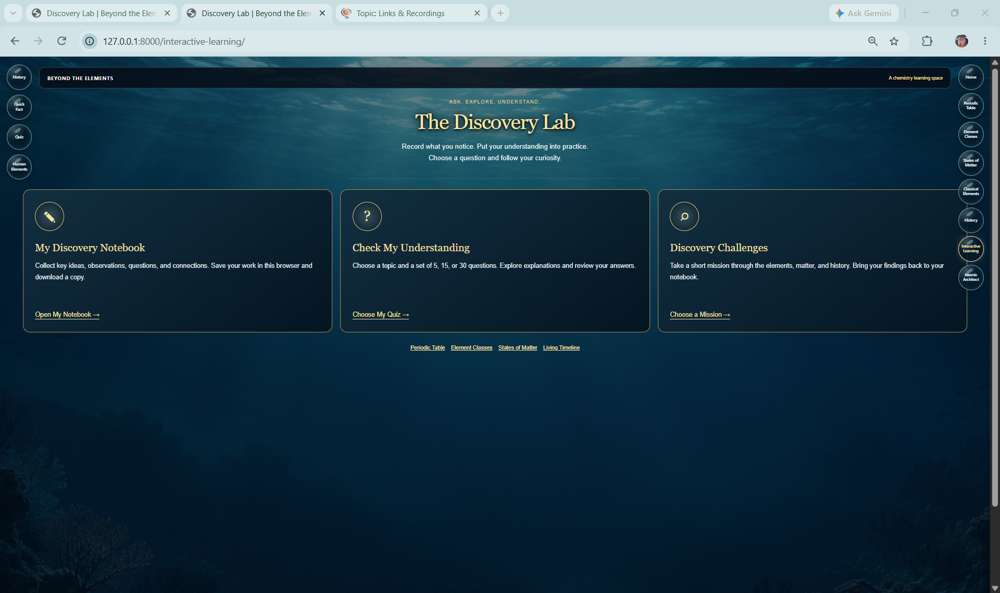
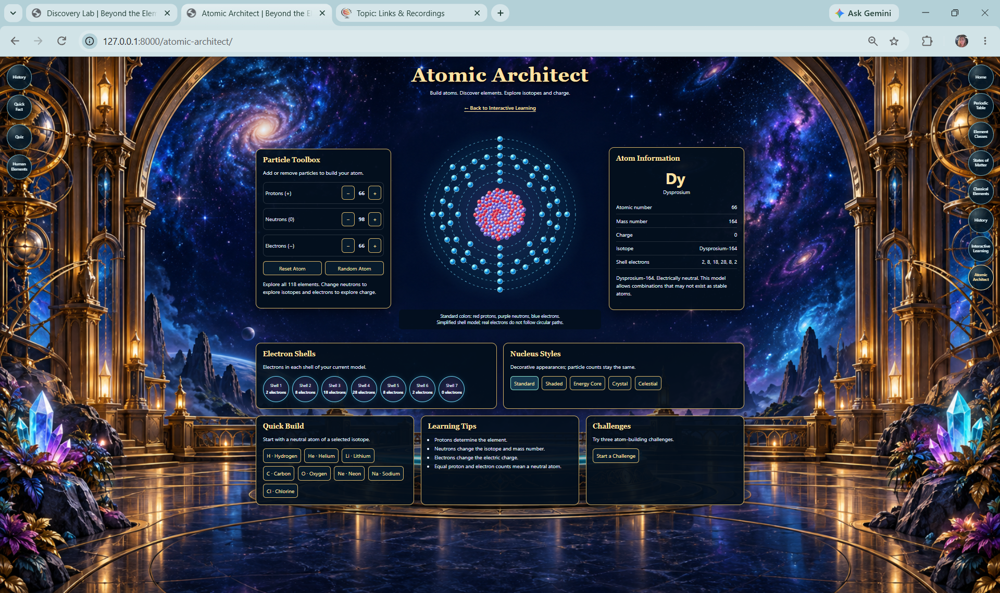

# Beyond the Elements

A chemistry learning website built with Django, connecting the elements to oceans, life, and distant stars.

## Current Features

- Home page with links to learning areas.
- Interactive periodic table covering all 118 elements.
- Element search by name, symbol, or atomic number.
- Element information dialog.
- Class Notes page ready for lesson content.
- Cosmic artwork and shared styling.

## Built With

- Python
- Django
- HTML and CSS
- JavaScript
- SQLite, currently configured as Django's database

## Getting Started

From the project folder, create and activate a virtual environment:

```powershell
python -m venv .venv
.\.venv\Scripts\Activate.ps1
```

If `.venv` already exists, activate it and continue.

Install the project dependencies:

```powershell
python -m pip install -r requirements.txt
```

Apply database migrations:

```powershell
python manage.py migrate
```

Start the development server:

```powershell
python manage.py runserver
```

Open http://127.0.0.1:8000/ in your browser.

## Pages

## Website Tour

Beyond the Elements brings chemistry concepts together through illustrated pages, interactive exploration, and guided practice.

### Home

An illustrated welcome to Beyond the Elements and its learning activities.



### Interactive Periodic Table

Explore the galaxy-inspired periodic table and search for elements.



### Element Classifications

Discover metals, nonmetals, and metalloids through illustrated category cards.



### States of Matter

Explore solids, liquids, gases, and plasma in four matching cards.



### Classical Elements

Explore historical ideas about fire, air, earth, water, and aether, alongside modern connections.



### The Living Timeline

Follow connected paths through scientific discovery and philosophical exploration.



### Discovery Lab — Interactive Learning

Organize class notes, practice by topic, and work through discovery challenges. Choose quizzes of 5, 15, or 30 questions, with answer feedback and review.



### Atomic Architect

Adjust protons, neutrons, and electrons to explore atomic identity, isotopes, and charge using a simplified shell model.



### Discovery Lab features

- Topic selection and mixed-topic practice.
- Quiz lengths of **5, 15, or 30 questions**.
- Randomized questions and answer choices, explanations, scoring, and missed-answer review.
- A class notebook with browser-based saving and text export.
- Discovery challenges with progress checklists.

Notebook entries and challenge progress are stored in the current browser on the current device; they do not sync between devices.

| Page | Address |
| --- | --- |
| Home | `/` |
| Class Notes | `/notes/` |
| The Elements | `/elements/` |
| Django Admin | `/admin/` |

Practice Lab is planned and is currently marked “Coming soon.”

## Project Structure

```text
118-Beyond_The_Elements/
├── chemistry/
│   ├── migrations/
│   ├── templates/
│   │   └── chemistry/
│   │       ├── elements.html
│   │       ├── home.html
│   │       ├── notes.html
│   │       └── practicelab.html
│   ├── models.py
│   ├── urls.py
│   └── views.py
├── config/
│   ├── settings.py
│   └── urls.py
├── Static/
│   ├── css/
│   │   └── style.css
│   ├── images/
│   └── js/
│       ├── element-details.js
│       └── periodic-table.js
├── manage.py
├── README.md
└── requirements.txt
```

## Templates and Static Files

Page templates live in `chemistry/templates/chemistry/`.

CSS, JavaScript, and images live in `Static/`. Keep the capital **S** in this folder name.

Load static files in Django templates with:

```django


<link rel="stylesheet" href="">

```

Use named routes for links:

```django
<a href="">Explore the Elements</a>
```

## Next Steps

- Integrate the six images: Solids, Liquids, Gases, Metals, Nonmetals, and Metalloids.
- Integrate the five-element pinwheel artwork.
- Preserve the existing 118-element periodic table and its interactions.
- Add class notes and learning content.
- Develop the Practice Lab.
- Expand element information with compounds and reaction examples.

Solids, liquids, and gases describe states of matter. Metals, nonmetals, and metalloids describe element classifications. Learning content should explain this distinction.

## Development Checks

Run Django's system checks after changes:

```powershell
python manage.py check
```

After editing templates, styles, or JavaScript, verify:

- Home and Class Notes still open.
- The periodic table displays correctly.
- Element search still works.
- Element dialogs open and close.
- The table remains usable on smaller screens.
- Images load without broken links.

Make changes one file at a time and review existing work before replacing it.

## Project Status

Beyond the Elements is under active development as a chemistry learning project.

The current Django settings are intended for local development. Production deployment will require separate configuration.

*Built one discovery at a time.*